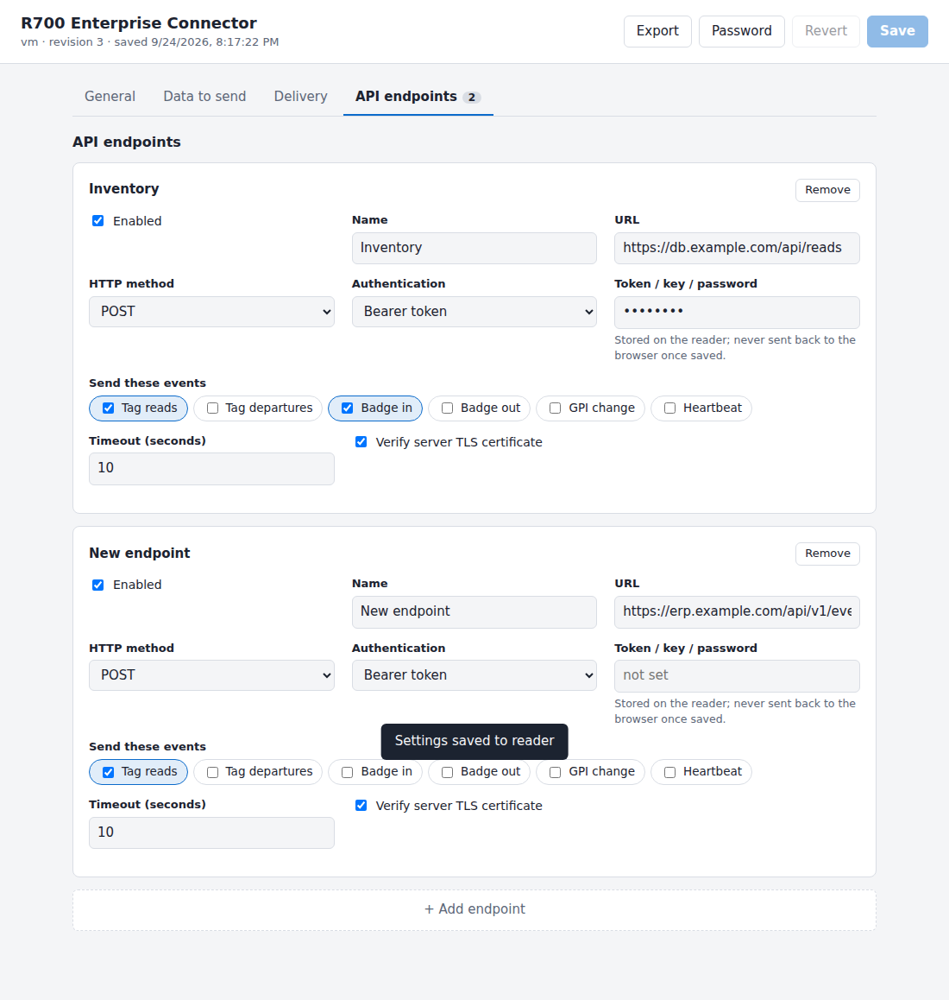

# custom_ui_cap: R700 CAP with a web configuration UI

A CAP for the Impinj R700 rev 2, FW 10.x (built with Octane ETK 10.3.0, same packaging as replenibin_cap). It runs a small HTTPS web server on the reader. The server serves a settings page with dropdowns, checkboxes and a list of API endpoints, and saves your choices to a JSON file on the reader.

```
cap_description.in       cap_gen.sh settings: Version, hardware, Input Directory=./cap
python-runtime.conf      pinned Python runtime (release, asset, SHA-256) bundled by build.sh
build.sh                 runs cap_gen.sh → custom_ui_cap_<version>.upgx
cap/                     packaged; appears on the reader as /cust (read-only)
  start                  entry point: logs diagnostics, then supervises the server (foreground, never exits)
  input_manifest.json    declares rw_dir/ as the only writable directory
  app.env                port override (default 8443)
  python/                bundled CPython 3.12 for aarch64 (generated by build.sh; not in git)
  app/server.py          Python 3 standard library only: HTTPS, Basic auth, REST API, validation
  app/schema.json        single source of truth: drives the UI AND server-side validation
  app/www/               index.html, app.js, style.css (no CDN; works on an air-gapped plant LAN)
  rw_dir/                /cust/rw_dir: config.json, auth.json, tls/, log/, diag.txt
```



## How it works
- **Browser → `https://<reader-ip>:8443/`** You log in with HTTP Basic auth. The first login is `admin` / `changeme`, and the page shows a banner until you change it.
- **The schema drives everything.** To add a dropdown or checkbox, add a field to `schema.json`. You don't have to change the UI or the server code. Supported field types: `select`, `multiselect` (checkbox chips), `checkbox`, `number`, `text`, `url`, `secret`, plus `list` sections for repeating items such as endpoints.
- **Saving (`PUT /api/config`)** The server checks every value against the schema and rejects unknown keys. It writes `config.json.tmp`, runs fsync, renames the file over `config.json` and fsyncs the directory, so a power cut never leaves a half-written file. It keeps the previous version as `config.json.bak`, and if `config.json` can't be read it falls back to the `.bak`. Each save increments `revision`. If two people edit at once, the second save gets a 409 conflict instead of silently overwriting the first.
- **Secrets** (endpoint tokens) stay on the reader. The browser only ever sees `********`. If a save sends back the mask, the server keeps the stored value. Secrets are matched to their endpoint by a hidden `_id`, so reordering or deleting endpoints can't attach a token to the wrong endpoint.
- **TLS** On first boot the server generates a self-signed cert for that reader, if `openssl` exists on the reader. If it doesn't, the server falls back to a cert that `build.sh` bundles into the CAP. That bundled cert is the same on every reader built from that CAP, so treat it as a stopgap.
- **Other hardening** A write from another site is refused (Origin check). Five wrong passwords lock that address out for 30 s. Passwords are stored as PBKDF2-SHA256 hashes. The page has a strict CSP.

## Build and deploy (WSL)
```sh
cd ~/custom_ui_cap
./build.sh            # ETK defaults to /opt/10.3.0_Octane_Embedded_Development_Tools (FW 10.x rejects CAPs from older ETKs)
```
Bump `Version` in `cap_description.in` for each build. Upload `custom_ui_cap_<version>.upgx` in the reader's web UI, reboot if prompted, then browse to `https://<reader>:8443/`.

Read-only rule: anything under `/cust` other than `rw_dir/` must never change at runtime, or the reader disables the CAP. That's why the server writes only to `rw_dir/` and Python bytecode caching is turned off.

Bench test without a reader:
```sh
python3 cap/app/server.py --data-dir ./devdata --port 8443   # add --insecure-http to skip TLS
```

## Python on the reader
The R700 FW 10.x OS has no Python, so `build.sh` bundles a self-contained CPython 3.12 for aarch64 (python-build-standalone, pinned and checksum-verified in `python-runtime.conf`, pruned to about 57 MB) into `cap/python/`. `start` runs `/cust/python/bin/python3`. The first download is cached in `~/.cache/custom_ui_cap/`.

At boot, `start` writes `rw_dir/diag.txt` (glibc, bundled Python and OpenSSL versions, libgcc_s, tools, free space). If no Python works, it serves that report at `http://<reader>:8443/diag.txt`.

## Still to confirm on a reader
1. **`Persistent Data = rw_dir`** (commented out for now): re-enable it, then install a newer version over an older one and check that settings survive.
2. **Firewall:** port 8443 has been confirmed reachable.

## Using the settings from the connector process
Your worker (the process that reads tags and posts to the APIs) reads the same file. It can poll the file's modification time, or `revision`, to pick up changes without a restart:
```python
import json, os
PATH = os.path.join(os.environ.get("CAP_DATA_DIR", "/cust/rw_dir"), "config.json")
_last = None
def settings_if_changed():
    global _last
    m = os.stat(PATH).st_mtime_ns
    if m != _last:
        _last = m
        with open(PATH) as f:
            return json.load(f)     # atomic rename means you never read a partial file
```

## Next steps
- Add a "Test endpoint" button that sends a sample payload from the reader and shows the HTTP status.
- Add a GPIO/LED status indicator and reader info (serial, FW, antenna hub) on a Status tab.
- Import settings from a file, so one exported config can be applied across a fleet.
